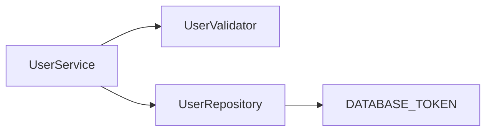

# Suites Examples

Runnable [Suites](https://suites.dev) examples for NestJS, Inversify, and InjectionJS with Jest or Vitest. Each example uses the same user management domain to demonstrate solitary tests, sociable tests, and a mocked database boundary.

## Run an example

Use Node.js `^22.22.2 || ^24.15.0 || ^26.0.0` and pnpm 12.16.1. From this repository:

```sh
cd nestjs-jest
pnpm install --frozen-lockfile --strict-peer-dependencies
pnpm test
```

Each example installs the **published Suites v4 packages from npm**. No source checkout, local tarballs, or preparation step is needed. `pnpm test` checks TypeScript declarations with `skipLibCheck: false`, then runs the tests.

New to Suites? Start with [Installation](https://suites.dev/docs/get-started/installation/) and [Quickstart](https://suites.dev/docs/get-started/quickstart/).

## Examples

| Example | Framework | Runner | Module configuration |
| --- | --- | --- | --- |
| [nestjs-jest](./nestjs-jest) | NestJS 12 | Jest 30 | CommonJS |
| [nestjs-vitest](./nestjs-vitest) | NestJS 12 | Vitest 5 | ESM |
| [inversify-jest](./inversify-jest) | Inversify 8 | Jest 30 | CommonJS |
| [inversify-vitest](./inversify-vitest) | Inversify 8 | Vitest 5 | ESM |
| [injectionjs-jest](./injectionjs-jest) | InjectionJS 2 | Jest 30 | CommonJS |
| [injectionjs-vitest](./injectionjs-vitest) | InjectionJS 2 | Vitest 5 | ESM |
| [advanced-mock-config](./advanced-mock-config) | NestJS 12 | Jest 30 | CommonJS |

The advanced example focuses on `.mock().final()` and `.mock().impl()`. InjectionJS examples also demonstrate `InjectionToken` overrides and identity: two tokens with the same description remain different dependencies.

These examples use the framework versions above. Suites also supports NestJS 10/11 and Inversify 7; the [Unit repository](https://github.com/suites-dev/unit) tests the full supported framework matrix. This repository's CI runs all seven examples on Node 22, 24, and 26, giving 21 jobs.

## Suites versions

The examples use `@suites/unit`, Jest/Vitest doubles, and the InjectionJS adapter at **4.1.0**. The NestJS and Inversify adapters use **4.0.1**. Shared packages follow Suites' independent versioning; not every package changes in each release.

[suites-versions.json](./suites-versions.json) records the expected versions, including transitive packages. Each example has its own lockfile. Check an installation from the repository root:

```sh
node scripts/verify-suites.mjs nestjs-jest
```

The verifier checks installed Suites versions, absence of postinstall declaration patching, and the configured adapter declarations. When upgrading, update the package manifests and version record together, regenerate each lockfile, and run every example.

## Type integration in v4

Each example includes `global.d.ts` with exactly one doubles `/unit` reference and one DI `/metadata` reference. For NestJS with Jest:

```typescript
/// <reference types="@suites/doubles.jest/unit" />
/// <reference types="@suites/di.nestjs/metadata" />
```

Use `@suites/doubles.vitest/unit` for Vitest, `@suites/di.inversify/metadata` for Inversify, or `@suites/di.injectionjs/metadata` for InjectionJS. Keep these declarations included in the test tsconfig. Suites no longer patches declarations during postinstall.

Import `TestBed`, `Mocked`, and `Stub` from `@suites/unit` after loading the declarations. Standalone `mock()` and `stub()` helpers come from the doubles adapter. See the [v3 to v4 migration guide](https://suites.dev/docs/migration-guides/from-v3/) for existing projects. Sinon is no longer supported.

## Testing strategies

**Solitary tests** construct one class with all dependencies mocked:

```typescript
const { unit, unitRef } = await TestBed.solitary(UserService).compile();
```

**Sociable tests** keep selected collaborators real and mock external I/O:

```typescript
const { unit, unitRef } = await TestBed.sociable(UserService)
  .expose(UserValidator)
  .expose(UserRepository)
  .compile();
const database = unitRef.get<Database>(DATABASE_TOKEN);
```

Every example uses this dependency graph:



Application code lives in `src/`; runnable tests live in `tests/`. Tests build a fresh TestBed for each scenario to avoid sharing mock state.

## InjectionJS boundaries

The adapter supports constructor injection with InjectionJS `^2.6.1`. Contextual `inject()` calls, provider factories, multi-providers, and production injector hierarchy rules are outside its scope. Optional constructor dependencies are mocked unless explicitly overridden.

The Vitest example externalizes `injection-js` through `test.server.deps.external` so the adapter and test code share decorator and token identities. Keep this setting when copying its configuration.

## Troubleshooting

- **Missing decorator metadata:** Keep `experimentalDecorators` and `emitDecoratorMetadata` enabled, use the included SWC transform, and load `reflect-metadata` before decorated classes.
- **Missing `Mocked` or token types:** Check `global.d.ts` and the test tsconfig's `include` paths. Do not combine multiple DI or doubles augmentations in one TypeScript project.
- **Installation errors:** Use a supported Node line and pnpm 12.16.1. Install inside the selected example directory.
- **InjectionJS token not found:** Import the original token instance. Recreating a token with the same description does not identify the same dependency.

## Learn more

- [Solitary tests](https://suites.dev/docs/guides/solitary/)
- [Sociable tests](https://suites.dev/docs/guides/sociable/)
- [Mock configuration](https://suites.dev/docs/api-reference/mock-configuration/)
- [InjectionJS guide](https://suites.dev/docs/guides/injectionjs/)
