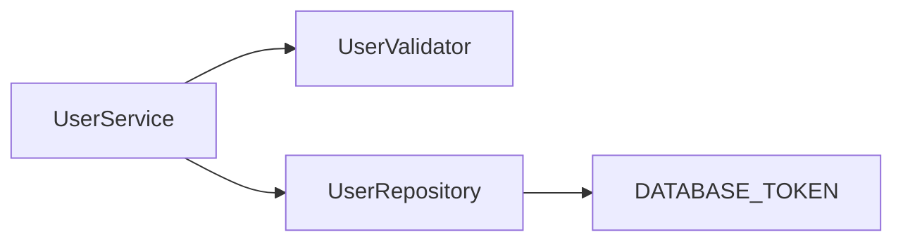

# Suites Examples

Real-world examples demonstrating [Suites](https://suites.dev) integration with popular dependency injection frameworks and test runners.

Each example showcases [solitary](https://suites.dev/docs/api-reference/testbed-solitary) and [sociable](https://suites.dev/docs/api-reference/testbed-sociable) testing patterns using the same user management domain model.

If you are new to Suites, check out the [Getting Started](https://suites.dev/docs/getting-started) guide.

## Examples

| Example                                        | DI Framework | Test Runner | Use When                                          |
| ---------------------------------------------- | ------------ | ----------- | ------------------------------------------------- |
| [nestjs-jest](./nestjs-jest)                   | NestJS       | Jest        | NestJS with Jest                                  |
| [nestjs-vitest](./nestjs-vitest)               | NestJS       | Vitest      | NestJS with Vitest                                |
| [inversify-jest](./inversify-jest)             | InversifyJS  | Jest        | InversifyJS with Jest                             |
| [inversify-vitest](./inversify-vitest)         | InversifyJS  | Vitest      | InversifyJS with Vitest                           |
| [advanced-mock-config](./advanced-mock-config) | NestJS       | Jest        | Advanced `.mock().final()` and `.impl()` patterns |

## Prepare the master packages

These examples test Suites 4 packages built from `suites-dev/unit` master at commit [`23422b3`](https://github.com/suites-dev/unit/commit/23422b3be202cd0b2b062e69514f2f7bada6613a). The exact revision and package versions are recorded in [suites-source.json](suites-source.json). This snapshot is `4.0.0-next.0`; it does not require a public npm prerelease.

Use **Node 26** and **pnpm 12.16.1** to build the packages once from the repository root:

```bash
node scripts/prepare-suites.mjs
cd nestjs-jest
pnpm install --frozen-lockfile --strict-peer-dependencies
pnpm test
```

The helper fetches the pinned source, builds all nine public packages, and packs them into the ignored `.suites-packages/` directory. Each example's pnpm overrides install those tarballs, including transitive Suites dependencies. Nothing is published to npm, and the examples do not link to the source workspace.

You can use an existing clean checkout at the pinned commit instead of downloading it:

```bash
node scripts/prepare-suites.mjs /path/to/unit-checkout
```

After preparation, run any example independently with `pnpm install --frozen-lockfile` and `pnpm test`. Tests first type-check the example, then exercise its solitary and sociable scenarios. CI repeats this for all five examples on Node 22, 24, and 26.

To test a newer master commit, update `suites-source.json`, align the examples' Suites versions with that source, rebuild the tarballs, and regenerate the example lockfiles with `pnpm install --no-frozen-lockfile`.

## Type integration

Each example includes `global.d.ts` with one test-double `/unit` reference and one DI `/metadata` reference. For NestJS with Jest:

```typescript
/// <reference types="@suites/doubles.jest/unit" />
/// <reference types="@suites/di.nestjs/metadata" />
```

Use `doubles.vitest` for Vitest and `di.inversify` for Inversify. These declarations are included in each test tsconfig. Suites no longer installs or edits type augmentations through postinstall hooks.

## Testing Strategies

Each example demonstrates two approaches:

### Solitary Unit Tests

```typescript
const { unit, unitRef } = await TestBed.solitary(UserService).compile();
```

Test one class in complete isolation. All dependencies are replaced with test doubles.

**When to use:**

- Testing component logic in isolation
- Controlling all inputs for predictable results

**Trade-off:** Does not verify interactions between components

### Sociable Unit Tests

```typescript
const { unit, unitRef } = await TestBed.sociable(UserService)
  .expose(UserValidator) // Use real validator
  .expose(UserRepository) // Use real repository
  .compile();
```

Test multiple classes together with their real collaborators. External I/O (databases, APIs, file systems) is replaced with test doubles to keep tests fast.

**When to use:**

- Verifying components work together correctly
- Testing interactions between business logic components

**Trade-off:** Slower execution, multiple failure points

Both strategies are unit tests - they keep external I/O mocked and remain fast. Use both together for comprehensive coverage.

## What Each Example Demonstrates

- **Solitary unit tests** - Test one class in complete isolation with all dependencies mocked
- **Sociable unit tests** - Test multiple classes together with real collaborators, external I/O mocked
- **Type-safe mocking** - TypeScript support through explicit adapter references
- **Zero boilerplate** - No test module configuration required

## Common Use Case

All examples implement the same user management service with three key components:



- **UserService** - Business logic layer with validation and persistence
- **UserValidator** - Email validation (no dependencies)
- **UserRepository** - Data access layer (depends on database token)

This consistent domain model makes it easy to compare different framework and test runner combinations.

## Repository Structure

```
examples/
├── nestjs-jest/          # NestJS with Jest
├── nestjs-vitest/        # NestJS with Vitest
├── inversify-jest/       # InversifyJS with Jest
├── inversify-vitest/     # InversifyJS with Vitest
└── advanced-mock-config/ # Advanced .mock().final() and .impl() patterns
```

Each example contains two directories:

**`src/`** - Application code being tested:

- `types.ts` - Domain types and interfaces
- `user.service.ts` - Business logic layer
- `user.validator.ts` - Validation logic
- `user.repository.ts` - Data access layer

**`tests/`** - Tests demonstrating Suites usage:

- `user.solitary.spec.ts` - Solitary unit tests (all dependencies mocked)
- `user.sociable.spec.ts` - Sociable unit tests (real collaborators, external I/O mocked)

## Prerequisites

- Node 26 to build the pinned source packages
- Node.js 22.22.2+, 24.15.0+, or 26.x to run examples
- pnpm 12.16.1
- Basic understanding of TypeScript and dependency injection

## Troubleshooting

### Tests fail after install

1. Check Node.js version: `node --version` (supported lines: 22.22.2+, 24.15.0+, or 26.x)
2. Check pnpm: `pnpm --version`
3. Prepare the source packages, then reinstall: `pnpm install --frozen-lockfile`
4. Verify working directory is the example directory, not repository root

### "reflect-metadata" errors (InversifyJS examples)

InversifyJS requires decorator metadata. Configuration is already set in `tsconfig.json` and imports. If errors occur, verify:

- `experimentalDecorators: true` in tsconfig.json
- `emitDecoratorMetadata: true` in tsconfig.json
- `import 'reflect-metadata'` at top of test files

### "Module not found" errors

Run `pnpm install` in the specific example directory. Each example has standalone dependencies. Prepare `.suites-packages/` from the repository root first.

## Learn More

- [Suites Documentation](https://suites.dev)
- [Testing Strategies Guide](https://suites.dev/docs/testing-strategies)
- [NestJS Integration](https://suites.dev/docs/nestjs)
- [InversifyJS Integration](https://suites.dev/docs/inversify)
